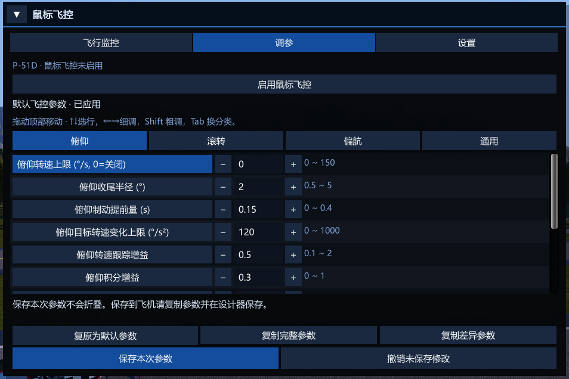

# 客制化飞控指南

[English](CUSTOM_FLIGHT_CONTROL.en.md) · [返回自述](README.md)

[制作与保存](#给作品制作一套参数) · [参数来源](#参数从哪里来) · [参数说明](#参数说明) · [按现象排查](#从现象选择起点) · [手写格式](#手写格式与读取失败)

适用于 **0.2.19**。本指南解释怎样给作品保存专属飞控，以及调参页全部 40 个参数的作用。下文默认值是当前版本新配置的默认值；升级保留的配置、作品参数与本次修改可能不同，请以面板实际值为准。

## 先认识三种动作

- **俯仰**：机头抬起或低下，主要靠水平尾翼控制。
- **滚转**：左右机翼倾斜，用来进入转弯或把机翼摆回水平。
- **偏航**：机头向左或向右转，主要靠方向舵控制。

这些参数决定插件怎样使用飞机已有的操纵能力，不会增加发动机推力、扩大舵面或修改气动。参数里的「转速」指机头或机翼每秒转过多少度，不是发动机转速。「杆量」指操纵力度：绝对值 `1` 是该方向满操纵，`0` 是不操纵。

## 给作品制作一套参数



1. 安装插件，载入自己的飞机进入飞行，打开「调参」页。查看当前来源，确认是在默认／本机参数还是已有作品参数上修改。
2. 启用鼠标飞控，在有代表性的速度下试飞。每次只改一项或一组紧密相关的参数，先小幅调整。
3. 点击「保存本次参数」应用，再重复同样的机动。编辑框中的修改不会立即改变飞控。
4. 满意后点击「复制完整参数」。复制会导出面板草稿；若还有未应用修改，应先应用并试飞再导出。
5. 回到设计器，选择一个合适的零件，将复制的 `MF;...` 文本粘贴到它的**名称**中。只选择一个零件承载参数，不要复制到多个零件上。
6. 保存作品，重新载入进入飞行，检查调参页的来源与数值，确认作品参数已读入，再分享作品。

可以保留零件原名，但原名与 `MF` 之间必须留空白，例如 `飞控参数 MF;MPR=0;MRR=100;MLR=35;MYR=15`。最简单的方式是把整个零件名称替换为面板复制出的文本。参数应放在名称末尾，不要在参数后追加普通说明文字。

这里的「保存本次参数」只保存并应用本次飞行的调校，**不会直接保存到作品，也不会改写配置文件**。更换作品或重新加载飞行后会重新读取来源。给作品永久保存参数，需要完成上面的粘贴名称与设计器保存步骤。

「撤销未保存修改」恢复上次已应用的参数；「复原为默认／作品参数」恢复来源参数到草稿，仍需点击「保存本次参数」才会应用。折叠面板不会保存或应用修改。

## 参数从哪里来

优先级由高到低为：

1. **本次面板已应用参数**。
2. **作品零件名称中明确写出的参数**。
3. **玩家本机插件配置**。
4. **插件内置默认值**，用于配置中未填写的项。

作品按单项覆盖。例如作品只写 `MF;MYR=15`，就只把偏航目标转速上限改为 `15`，其余参数仍用下载者本机配置。完整导出包含当前全部 40 项，可以减少玩家之间本机配置差异的影响；未来新增的参数仍需按新版本规则读取。

| 复制方式 | 内容 | 适合用途 |
|---|---|---|
| 复制完整参数 | 面板当前全部 40 项 | 给作品保存并分享完整调校，推荐使用 |
| 复制差异参数 | 与当前玩家本机插件配置不同的项 | 有意让作品只覆盖少数项目 |

差异比较对象是**本机插件配置**，不是内置默认值，也不是作品原来的参数。复制不会自动应用草稿，不会自动保存作品。

安装插件的玩家在多人房间中也能使用自己的鼠标飞控。未安装插件的玩家仍能下载、载入并用游戏原有操纵驾驶这些作品；零件名称中的参数对他们不产生飞控效果。

## 参数说明

[俯仰](#俯仰抬头低头与对准收尾) · [滚转](#滚转进入转弯与回平) · [偏航](#偏航方向舵参与与左右对准) · [通用](#通用响应平滑与方向)

每项同时列出完整名称和导出简称，方便与零件名称核对。日常调参直接使用面板，不需要手写这些名称。角度单位为度，`°/s` 是每秒多少度，`s` 是秒，`°/s²` 表示要求的转速每秒最多增加多少。

**把转速上限设为 `0` 是关闭这一项限制，不是要求飞机停止转动。**关闭后仍受飞机本身的能力、其他参数和最大操纵量影响。这些是目标转速限制，不是攻角限制或失速保护。尤其注意：俯仰默认关闭限制，滚转、回平与偏航默认仍保留限制。

### 俯仰：抬头、低头与对准收尾

#### 俯仰转速上限

`MaxPitchRate` / `MPR`

**默认：** 0 · **范围：** 0–150 °/s

正数限制插件要求的抬头／低头速度，越小越保守；`0` 关闭限制。增大不能保证超过飞机本身的能力。

#### 俯仰收尾半径

`PitchArrivalRadius` / `PAR`

**默认：** 2 · **范围：** 0.5–5°

接近目标时逐渐降低要求的转速。越小，维持较强转向到越靠近准星；越大，收尾更宽、更缓。默认半径 2° 对应约 4° 宽，不是完全不操纵的死区。

#### 俯仰制动提前量

`PitchBrakingLead` / `PBL`

**默认：** 0.15 · **范围：** 0–0.4 s

根据机头当前转动速度，提前收杆以减少冲过目标。越大越早收杆，过大可能显得迟迟贴不近准星；`0` 关闭这项提前预测。制动可能发生在收尾半径外。

#### 俯仰转速增加速度

`PitchDemandAcceleration` / `PDA`

**默认：** 120 · **范围：** 0–1000 °/s²

控制要求的俯仰转速怎样逐步增加。小值起步柔，大值起步快；`0` 关闭渐增限制。减少转速或反向要求不受这项渐增限制。

#### 俯仰速度修正力度

`PitchRateTrackingGain` / `PTG`

**默认：** 0.5 · **范围：** 0.1–2

实际抬头／低头速度与要求不一致时，补多少操纵来纠正。大值追得紧，小值较柔；过大可能来回修正或震颤。

#### 持续俯仰补杆

`PitchRateIntegralGain` / `PIG`

**默认：** 0.3 · **范围：** 0–1

飞机持续转得不够时，逐渐补上维持转动所需的操纵。大值补得快，也可能留下更多需要收回的杆量；`0` 关闭这项持续补杆。

#### 俯仰突然加速抑制

`PitchAccelerationDamping` / `PAD`

**默认：** 0.05 · **范围：** 0–0.2

抑制俯仰转动速度的突然变化。增大可能减轻猛然抬头，但也可能造成迟滞或震颤，需小步试飞；`0` 关闭。

#### 残留补杆撤去力度

`PitchIntegralReleaseGain` / `PIR`

**默认：** 2 · **范围：** 0–5

已经需要明显减速时，更快撤去仍在推动转动的持续补杆。大值撤得快，小值撤得慢；`0` 只关闭额外撤去力度，正常补杆调整仍然存在。

#### 快速响应保护

`PitchFastResponseProtection` / `PFP`

**默认：** 开启（1） · **范围：** 0 / 1

检测到飞机对操纵反应很快时，降低本次接管中的部分俯仰修正敏感度。适合反应过激的飞机，但可能让修正更柔；不是攻角、失速或过载保护。

#### 稳定对准补偿学习速度

`PitchBalanceGain` / `PBG`

**默认：** 0.035 · **范围：** 0–0.1

机头已接近准星且姿态稳定时，逐渐寻找保持对准所需的一点持续推／拉杆。大值学得快，小值慢；`0` 关闭。不会自动保持高度。

#### 稳定对准补偿最大力度

`PitchBalanceLimit` / `PBC`

**默认：** 0.25 · **范围：** 0–0.4

限制上项能保留的推／拉杆大小。大值允许补得更多，小值约束更紧；`0` 关闭这项补偿。这不是游戏原有配平通道。

#### 稳定对准补偿变化速度

`PitchBalanceSlew` / `PBS`

**默认：** 0.025 · **范围：** 0.001–0.1 /s

上述补偿每秒最多改变多少杆量。小值慢慢找平衡，大值调整更快；需要与学习速度和最大力度一起考虑。

俯仰上限设为 `0` 时，要求的转速会随剩余俯仰偏差增加，收尾半径也会影响远离准星时的要求：半径越小，整体俯仰要求越积极。因此，默认不限速时调整收尾半径，不只是改变最后几度的手感。

稳定对准补偿只在接近准星、机翼较平且转动较慢等条件满足时学习，不能用来纠正任意机动中的偏差，也不会保存为下一次飞行的自动测量结果。

### 滚转：进入转弯与回平

回平有两个环节：先判断飞机是否已经接近目标且机头转动足够慢，再决定回平与继续朝目标倾斜的比例。不是进入某个角度圈后就立刻强制回平。

#### 机翼回平力度

`WingsLevelGain` / `WLG`

**默认：** 1.33 · **范围：** 0.5–3

回平时纠正机翼倾斜的积极程度。大值回得更积极，小值更柔；仍受回平转速与输出变化限制影响。

#### 回平转速上限

`MaxLevelRollRate` / `MLR`

**默认：** 45 · **范围：** 0–200 °/s

限制回平时要求的滚转速度。减小可放慢回平；`0` 关闭这一上限。和进入转弯的滚转上限分开设置。

#### 朝目标滚转上限

`MaxRollRate` / `MRR`

**默认：** 120 · **范围：** 0–400 °/s

限制朝目标倾斜机翼时要求的滚转速度。小值较慢，大值允许更快；`0` 关闭这一上限。

#### 滚转收杆力度

`KdRoll` / `KDR`

**默认：** 0.15 · **范围：** 0–0.3

根据已经发生的滚转，给出反向收杆，减少继续滚过头。大值制止转动更积极，也可能使滚转乏力；`0` 关闭这项收杆。

#### 滚转转速增加速度

`RollDemandAcceleration` / `RDA`

**默认：** 600 · **范围：** 0–2000 °/s²

小值让要求的滚转速度逐渐增加，大值起步更快；`0` 关闭渐增限制。减少或反向要求即时生效。

#### 回平过渡起点

`BankBlendStart` / `BBS`

**默认：** 0.3 · **范围：** 0.2–90°

满足回平进入条件后，偏差低于此值时以回平为主。增大可使更大的偏差也倾向回平；与过渡终点一起调整。

#### 朝目标过渡终点

`BankBlendEnd` / `BBE`

**默认：** 2 · **范围：** 0.5–120°

过渡计算中，偏差达到此值时完全倾向朝目标滚转；起点与终点间渐变。增大可拓宽过渡范围。须至少比起点大 1°。

#### 竖直目标让位内界

`VerticalFadeStart` / `VFS`

**默认：** 10 · **范围：** 2–45°

目标距离飞机自身正上／正下方向小于此角度时，回平最大程度让位。增大可扩大最大让位范围；这是机身方向，不是地面水平。

#### 竖直目标让位外界

`VerticalFadeEnd` / `VFE`

**默认：** 30 · **范围：** 5–90°

超过此角度，恢复普通回平计算；内外界之间渐变。增大可扩大渐变覆盖范围。须至少比内界大 1°。

#### 滚转模式过渡时间

`BlendSmoothing` / `BS`

**默认：** 0.15 · **范围：** 0–0.5 s

平滑回平与朝目标滚转之间的切换。大值切换柔但慢，小值直接；`0` 不平滑。不会单独限制所有滚转动作的速度。

#### 回平进入角

`RollCaptureAngle` / `RCA`

**默认：** 0.8 · **范围：** 0.2–2°

机头距准星必须足够近才允许回平。减小可让回平更晚发生，增大允许更早；还须满足转速与确认时间要求。

#### 回平退出角

`RollCaptureExitAngle` / `RCE`

**默认：** 3 · **范围：** 0.7–10°

已进入回平后，偏差超过此值才退出。大值减少反复切换，但可能更久保持回平；须至少比进入角大 0.5°。

#### 回平允许机头转速

`RollCaptureRate` / `RCR`

**默认：** 6 · **范围：** 1–20 °/s

机头上下、左右转动的合成速度必须低于此值才允许回平。小值等机头更稳定，大值允许更早回平。**不是机翼滚转速度上限。**

#### 回平确认时间

`RollCaptureDwell` / `RCD`

**默认：** 0.08 · **范围：** 0–0.5 s

接近且转得慢的条件需持续多久。大值避免短暂路过准星就回平，小值更快确认；`0` 不等待。

### 偏航：方向舵参与与左右对准

#### 偏航转速上限

`MaxYawRate` / `MYR`

**默认：** 20 · **范围：** 0–60 °/s

限制插件要求的左右转头速度。减小更保守，增大允许更快；`0` 关闭这一上限。

#### 偏航收杆力度

`KdYaw` / `KDY`

**默认：** 0.3 · **范围：** 0–0.5

根据已经发生的左右转动收杆，抑制摇摆。大值更积极制动，也可能让转头变慢；`0` 关闭这项收杆。

#### 大转弯方向舵份额

`YawInTurnShare` / `YTS`

**默认：** 0.75 · **范围：** 0–1

朝目标倾斜机翼时，保留多少方向舵瞄准作用。大值更多参与，小值更多让位给滚转；`0` 只撤去这部分瞄准作用，不保证方向舵完全不动。

#### 运动变化方向舵协助

`YawCoordStrength` / `YCS`

**默认：** 0.6 · **范围：** 0–1.5

根据实际前进方向相对机身的横向变化，追加方向舵协助。大值参与多，也可能左右摇摆；`0` 关闭这项协助。不是直接把机头与速度方向强制重合。

#### 较大偏差瞄准力度

`YawAimGain` / `YAG`

**默认：** 1.6 · **范围：** 0.5–2

离准星较远时，方向舵追目标的积极程度。大值更积极，小值更柔；与精细力度之间平滑过渡。

#### 接近准星瞄准力度

`YawFineGain` / `YFG`

**默认：** 2 · **范围：** 0.5–2.5

接近准星时的方向舵力度。大值改善细小左右指向，也可能引起摆动；小值更稳但慢。约 0.3° 至 6° 间逐渐过渡到较大偏差力度。

#### 偏航制动提前量

`YawBrakingLead` / `YBL`

**默认：** 0.05 · **范围：** 0–0.4 s

根据当前左右转动速度提前收杆。大值更早制动，小值更贴近才收；`0` 关闭这项提前预测。

#### 偏航操纵力度

`YawDemandGain` / `YDG`

**默认：** 0.8 · **范围：** 0.2–1.5

把要求的左右转头速度换算成操纵力度。大值给舵更多，小值较保守；影响瞄准与运动协助的合成要求。过大可能摆动。

### 通用：响应、平滑与方向

#### 滚转／偏航响应时间

`AttitudeResponse` / `AR`

**默认：** 0.35 · **范围：** 0.05–2 s

小值更急于纠正滚转与偏航偏差，大值更柔。**当前不控制俯仰响应**。太小可能过激。

#### 测得转速平滑时间

`RateSmoothing` / `RS`

**默认：** 0.06 · **范围：** 0–0.3 s

平滑飞控使用的转动速度数据。大值过滤更多快速波动，也带来更多延迟；小值更及时。`0` 不平滑；不是画面平滑设置。

#### 三轴操纵变化速度

`OutputSlew` / `OS`

**默认：** 6 · **范围：** 0.5–30 /s

限制自动飞控每秒最多改变多少杆量。小值柔但可能追不上，大值反应直接；`6` 表示每秒最多变化 6 个杆量单位。不会改写玩家手动输入的原始灵敏度。

#### 滚转方向

`RollSign` / `RSG`

**默认：** 1 · **范围：** -1 或 1

仅在朝目标滚转方向反了时翻转。不是调整力度，也不能填 `0`。

#### 俯仰方向

`PitchSign` / `PSG`

**默认：** -1 · **范围：** -1 或 1

仅在要求抬头却低头、或反过来时翻转。默认负号用于对应游戏的俯仰输入方向，不代表俯仰力度为负。

#### 偏航方向

`YawSign` / `YSG`

**默认：** 1 · **范围：** -1 或 1

仅在要求向右却向左、或反过来时翻转。不是增强方向舵的方法。

## 从现象选择起点

下面是排查顺序，不是所有飞机通用的推荐数值。也要先检查速度、舵面能力、重心，以及游戏自身的自动驾驶是否同时参与。

| 现象 | 可以先检查 |
|---|---|
| 拉向远处目标明显太慢 | 是否设了较低的俯仰上限；再观察俯仰修正力度、转速增加速度与三轴操纵变化速度 |
| 接近准星时长时间贴不近 | 收尾半径或提前制动是否过大；持续补杆是否太弱 |
| 转弯结束回平太早，机头上冲 | 减小回平进入角或允许机头转速，适当延长确认时间；再检查回平速度与俯仰制动 |
| 机翼回平太快、显得僵硬 | 降低回平转速或力度，检查滚转模式过渡时间 |
| 大转弯左右摇摆 | 先小幅降低大转弯方向舵份额或运动变化协助，再检查偏航操纵力度与制动 |
| 小角度左右对准太慢 | 检查精细瞄准力度、偏航上限与操纵力度；不要同时大幅提高全部项目 |
| 高速俯仰震颤 | 保持快速响应保护开启，先小幅降低俯仰速度修正力度；再分别检查突然加速抑制和转速平滑，不能假定越大越稳定 |

每次用同一架飞机、相近速度与高度，重复小角度指向、较大转弯、接近目标收尾，以及键盘操纵松开后的接回。最后在低速、常用速度和高速各检查一次。需要对比时可以录制诊断数据，但不必先采集大量数据才能开始手动调参。

## 手写格式与读取失败

例如只想限制滚转、回平与偏航，并关闭俯仰上限，可以写：

```text
MF;MPR=0;MRR=100;MLR=35;MYR=15
```

这只是语法示例，不是一套适合所有飞机的建议值。也可用完整名称，例如 `MF;MaxYawRate=15`。

- 前缀必须是大写 `MF`，出现在名称开头或空白之后，后面跟分号或结束。参数名称与简称不区分大小写。
- 使用英文分号 `;`、等号 `=` 和小数点 `.`；不要附加单位。开关项可以用 `0`／`1` 或 `false`／`true`。
- 一个作品只允许一个带 `MF` 前缀的零件。多个这样的零件会使整套作品参数被拒绝，退回本机配置。
- 同一参数不能重复，完整名称与简称也算同一项。格式错误、越界或成对关系不成立会使整套作品参数被拒绝。
- 未知参数会被忽略并记录警告；不要依靠拼错名称来关闭参数。
- 过渡终点须至少比起点大 1°；竖直目标外界须至少比内界大 1°；回平退出角须至少比进入角大 0.5°。缺省项与本机配置合并后也必须满足这些关系。

如果来源没有显示为作品参数，先检查这一个零件的名称、是否重复放置了参数零件，以及是否保存并重新载入。需要进一步检查时，查看 BepInEx 日志中的作品参数读取消息。
