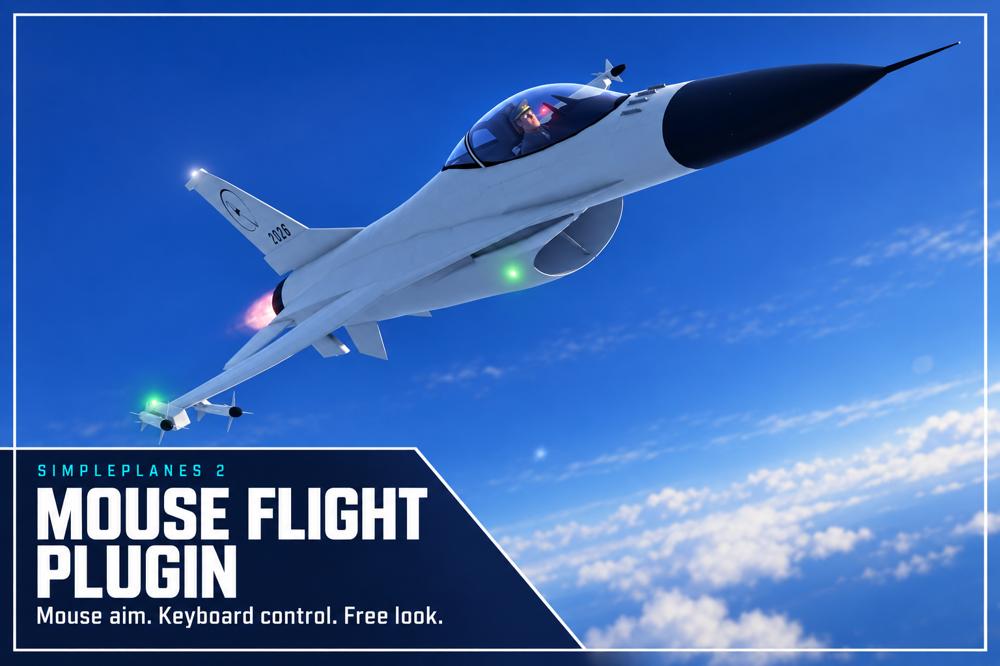
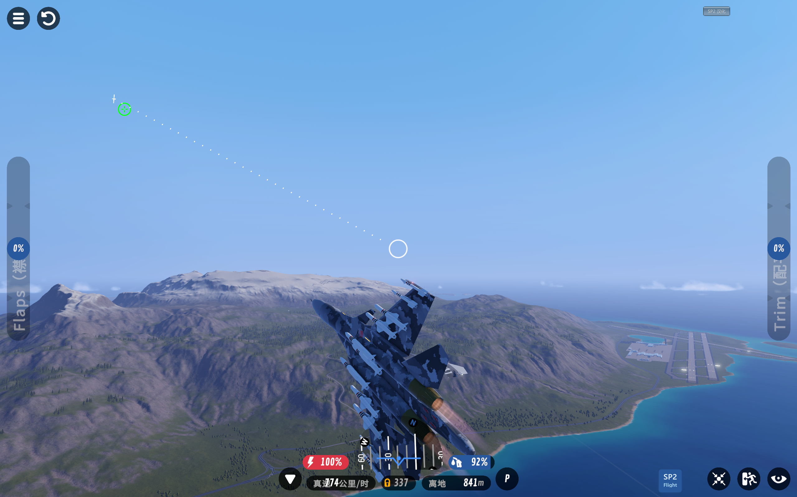
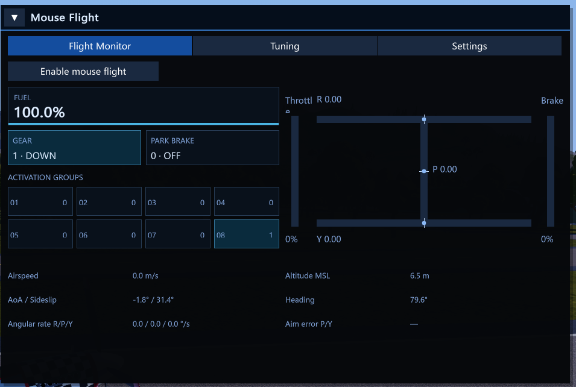
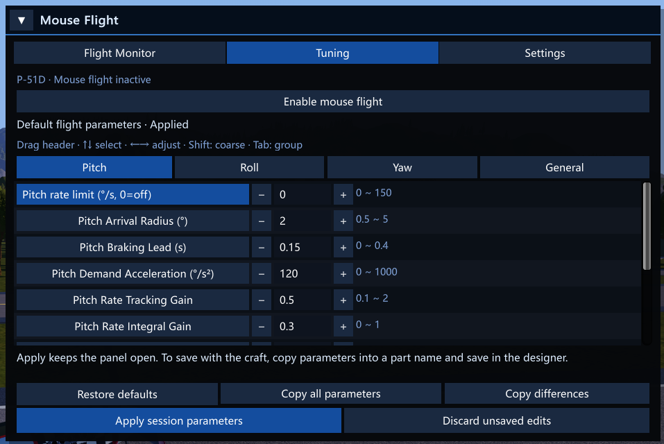
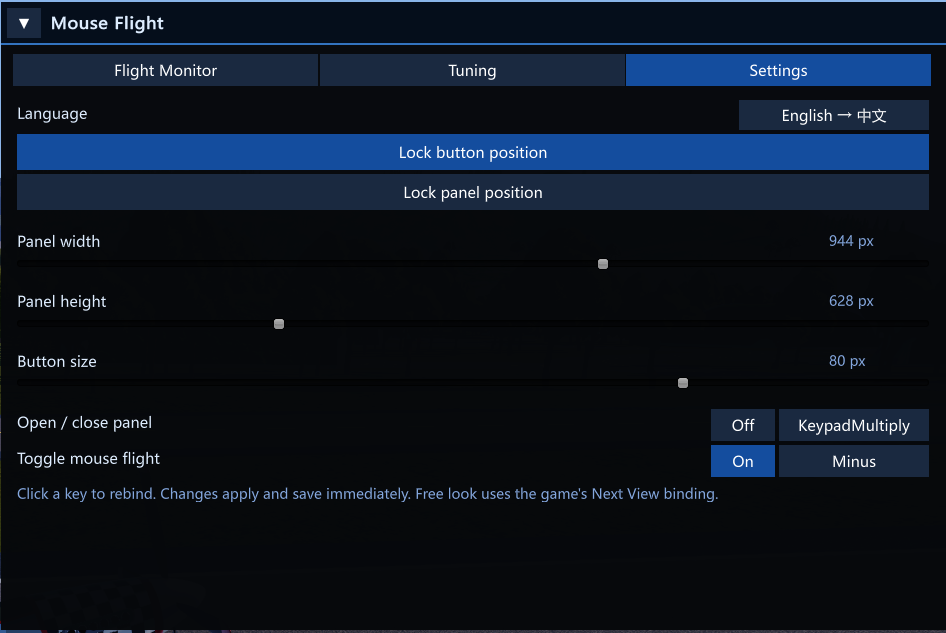

# SimplePlanes 2 Mouse Flight

[简体中文](README.md) · **Version 0.2.19**

A mouse-flight plugin for SimplePlanes 2. Point the mouse where you want to fly, and the plugin controls the aircraft toward the reticle. Use the game's normal controls whenever you want to take over. Includes a dedicated flight camera, free look, monitoring and tuning, and custom flight-control parameters saved with your craft.



[Installation](#installation) · [Getting started](#getting-started) · [Panel](#panel) · [Custom flight controls](#how-to-make-custom-flight-controls-for-your-craft) · [Multiplayer](#multiplayer-and-craft-compatibility)

## Installation

### Install BepInEx

Requires **BepInEx 5, Windows Mono x64**. BepInEx is a separately installed plugin loader. If it is already installed, skip to “Install the mouse-flight plugin.”

Get a BepInEx package from the [BepInEx releases page](https://github.com/BepInEx/BepInEx/releases) and extract it into the directory containing `SimplePlanes 2.exe`. It should contain `winhttp.dll`, `doorstop_config.ini` and `BepInEx/`. Launch the game once and quit to generate `plugins/` and `config/`. This installs BepInEx; install the mouse-flight plugin separately as described below.

### Install the mouse-flight plugin

1. Close the game. Download `SimplePlanes2MouseFlight-Release.zip` from **Assets** on the [latest release page](https://github.com/hahaha8459812/simpleplanes2-mouse-flight-plugin/releases/latest), then extract `SimplePlanes2MouseFlight.dll`. BepInEx is not included. The `Source code` downloads are source archives; use the named release package to install the plugin.
2. Manually create a `SimplePlanes2MouseFlight` folder under the game's `BepInEx/plugins/` directory.
3. Put `SimplePlanes2MouseFlight.dll` in that folder, giving the structure below.

When updating, use the existing folder and replace its DLL. Avoid leaving another copy elsewhere.

```text
SimplePlanes 2/
└─ BepInEx/
   └─ plugins/
      └─ SimplePlanes2MouseFlight/
         └─ SimplePlanes2MouseFlight.dll
```

The configuration is generated on first load at `BepInEx/config/com.codex.simpleplanes2.mouseflight.cfg`.

## Getting started



1. Enter a flight scene and wait for the aircraft to load.
2. Press main-keyboard `-` to enable mouse flight, or use the enable button on the Monitor or Tuning page.
3. Place the ring in your intended flight direction. The small cross marks the nose direction; the dashed line shows the difference.
4. Use the game's normal flight controls for manual maneuvers. Player input takes priority on the corresponding axis; automatic control returns smoothly after release.
5. Press `-` again or use the panel switch to release flight control and the camera.

The plugin reads player control input received by the game, so custom game bindings work without requiring fixed WASD/QE keys.

### Flight toggle and panel

These actions do not require mouse flight to be enabled first.

| Default action | Function |
|---|---|
| Main-keyboard `-` | Enable / disable mouse flight |
| Numpad `*` | Expand / collapse the panel |

Settings lets you rebind and independently enable or disable the panel and mouse-flight hotkeys. Disabled hotkeys retain their bindings.

### Controls with mouse flight enabled

**These actions describe operation with mouse flight enabled.** Free look follows the game's Next View binding.

| Default action | Function |
|---|---|
| Hold the game's Next View binding | Enter free look; release to return to the flight camera |
| Hold and drag the left button in free look | Orbit around the aircraft |
| Mouse wheel | Use the game's native camera zoom |
| Left button in normal mouse-flight view | Fire guns |
| Right button in normal mouse-flight view | Use the selected secondary weapon |

### Flight control during free look

During free look, if the flight target remains on screen, releasing manual controls makes the aircraft follow the original target again. If the target is off screen and the player supplies flight-control input, control becomes fully manual and the target follows the nose. This remains active even if the target returns on screen. Releasing free look sets the target to the current nose direction and restores mouse flight.

### Diagnostic recording

Recording hotkeys also work while mouse flight is disabled.

| Default action | Function |
|---|---|
| Main-keyboard `/` | Start / stop diagnostic recording |
| Main-keyboard `\` | Mark the next test segment in a recording |

## Panel

The launcher button and panel can be moved separately. The button stays visible and shows its active state while the panel is open. Panel visibility and flight control are independent: opening or collapsing the panel does not enable or disable flight control, or save parameters. Hold free look to regain the pointer and operate the panel during mouse flight.

| Page | Contents |
|---|---|
| Monitor | Three control axes, throttle and brake, speed, altitude and other flight data; numeric cards for fuel, activation groups, landing gear and parking brake |
| Tuning | Parameter source and application state, editable parameters, session application, and full or difference export |
| Settings | Chinese / English, button and panel position locks, sizes, hotkey bindings and enable switches |

**Session save applies parameters only to the current flight.** It does not write them into the craft or local configuration. Changing craft or reloading flight reads the parameter sources again.

The gear card shows the command state, rather than whether the gear has physically finished extending or retracting.

### Flight Monitor



### Tuning



### Settings



## How to make custom flight controls for your craft

Open Tuning during flight, adjust and apply parameters, then test them. Once satisfied, copy the full parameters, return to the designer, paste the `MF;...` text into the name of **one part**, and save the craft. The plugin reads these parameters automatically the next time the craft is loaded into flight.

Craft parameters override individual fields: specifying one replaces only that field; the rest use the player's local configuration. Use full export when you want other players to receive a similar tune.

See the separate **[Custom Flight Control Guide](CUSTOM_FLIGHT_CONTROL.en.md)** for the workflow, full versus difference export, parameter priority, and all 40 tuning fields explained through aircraft behavior. No flight-control engineering background is required.

## Multiplayer and craft compatibility

**With the plugin installed, mouse flight also works in multiplayer rooms.** It controls your own aircraft and does not require other players in the room to install it.

**Players without the plugin can still download, load and fly craft containing custom flight-control parameters.** Parameters are stored in a part name and do not make the craft require the plugin to load. These players cannot use the plugin's mouse flight, and the custom parameters have no effect for them.

## Current limitations

With the default flight-control parameters, some aircraft with highly effective control surfaces may exhibit periodic oscillation.

## Build from source

On Windows, install the game, BepInEx 5 and the .NET Framework C# compiler. Run this from the repository directory with your own game path:

```powershell
.\build.ps1 -GameDir "D:\Your game path\SimplePlanes 2"
```

The output is `artifacts/SimplePlanes2MouseFlight.dll`. Add `-InstallToGame` to install it as well, with the game closed.

## References and credits

The following mouse-flight projects informed development:

- [MouseFlight](https://github.com/brihernandez/MouseFlight): Brian Hernandez.
- [wt-mouse-aim](https://github.com/cosistra/wt-mouse-aim): cosistra.
- [MouseAimFlight](https://github.com/tetryds/MouseAimFlight): BahamutoD, ferram4, tetryds.

## Uninstall

Close the game and remove the plugin DLL from `BepInEx/plugins/SimplePlanes2MouseFlight/`. Keep or delete the configuration as desired. Craft names containing `MF` parameters can remain; normal flight controls still work.
