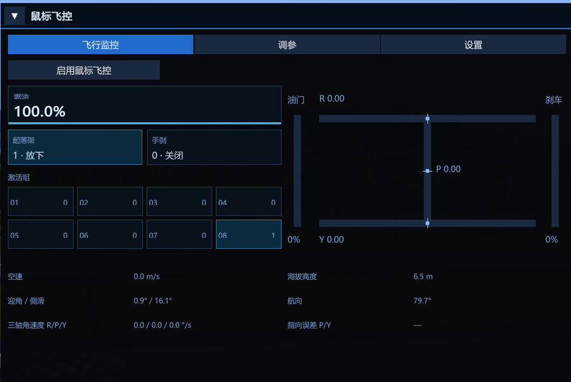
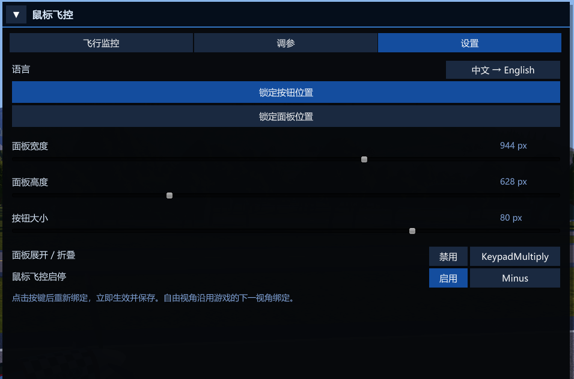

# SimplePlanes 2 Mouse Flight

[English](README.en.md) · **版本 0.2.19**

SimplePlanes 2 的鼠标飞控插件。用鼠标指定飞行方向，插件操纵飞机追随准星；也可以随时用游戏原有的键盘操纵接手。提供专属飞控镜头、自由视角、飞行监控与调参面板，并支持随作品保存客制化飞控参数。


[安装](#安装) · [开始使用](#开始使用) · [面板](#面板) · [客制化飞控](#怎么给你的作品制作客制化飞控) · [多人兼容性](#多人与作品兼容性)

## 安装

### 安装 BepInEx

本插件需要 **BepInEx 5，Windows Mono x64 版本**。BepInEx 是单独安装的插件加载器；如果已经安装，跳到「安装鼠标飞控插件」。

从 [BepInEx 发布页](https://github.com/BepInEx/BepInEx/releases) 获取 BepInEx 安装包，解压到游戏根目录，也就是 `SimplePlanes 2.exe` 所在目录。目录应包含 `winhttp.dll`、`doorstop_config.ini` 和 `BepInEx/`。启动一次游戏再退出，让 BepInEx 生成 `plugins/` 与 `config/` 目录。这一步安装的是 BepInEx，鼠标飞控插件需要按下一节安装。

### 安装鼠标飞控插件

1. 关闭游戏，从[最新发布页](https://github.com/hahaha8459812/simpleplanes2-mouse-flight-plugin/releases/latest)的 **Assets** 中下载 `SimplePlanes2MouseFlight-Release.zip`，解压得到 `SimplePlanes2MouseFlight.dll`。插件发布包不含 BepInEx；`Source code` 是源码包，安装插件请下载上述成品包。
2. 在游戏的 `BepInEx/plugins/` 下手动新建 `SimplePlanes2MouseFlight` 文件夹。
3. 把 `SimplePlanes2MouseFlight.dll` 放入这个文件夹，最终目录如下。

更新时使用原有文件夹，替换其中的 DLL，避免在其他目录留下另一份插件。

```text
SimplePlanes 2/
└─ BepInEx/
   └─ plugins/
      └─ SimplePlanes2MouseFlight/
         └─ SimplePlanes2MouseFlight.dll
```

首次加载后，配置文件生成在 `BepInEx/config/com.codex.simpleplanes2.mouseflight.cfg`。

## 开始使用


1. 进入飞行场景，等待飞机加载完成。
2. 按主键盘 `-` 启用鼠标飞控，也可以在面板的「飞行监控」或「调参」页点击启用按钮。
3. 移动鼠标，将圆环放到想飞向的方向。小十字表示机头指向，虚线表示两者之间的偏差。
4. 需要手动机动时，使用游戏原本的操纵键。玩家输入优先控制对应轴，松开后自动飞控平滑接回。
5. 再次按 `-` 或点击面板中的开关，交还操纵与镜头。

插件读取游戏收到的玩家操纵输入，支持游戏自定义键位，无需固定使用 WASD/QE。

### 开关与面板

以下操作无需先启用飞控。

| 默认操作 | 功能 |
|---|---|
| 主键盘 `-` | 启用／关闭鼠标飞控 |
| 小键盘 `*` | 展开／折叠面板 |

设置页可以修改面板热键和飞控热键，并分别启用／禁用；禁用后保留绑定。

### 飞控启用后的操作

**以下为鼠标飞控已启用时的操作方式。**自由视角跟随游戏的「下一视角」设置。

| 默认操作 | 功能 |
|---|---|
| 按住游戏的「下一视角」绑定 | 进入自由视角，松开返回飞控镜头 |
| 自由视角下按住左键拖动 | 环绕观察飞机 |
| 滚轮 | 使用游戏原有的镜头缩放 |
| 普通飞控视角下左键 | 发射机炮 |
| 普通飞控视角下右键 | 使用当前副武器 |

### 自由视角中的操纵

自由视角中，飞控目标仍在屏幕内时，键盘机动后松开操纵，飞机会继续追随原目标。目标在屏幕外且玩家输入了操纵时，会进入纯玩家操纵，目标随飞机机头移动；即使目标重新进入屏幕，也会保持该状态，直到松开自由视角键，再以当前机头方向接回飞控。

### 诊断记录

记录热键可以在未启用飞控时使用。

| 默认操作 | 功能 |
|---|---|
| 主键盘 `/` | 开始／停止诊断记录 |
| 主键盘 `\` | 在记录中标记下一段测试 |

## 面板

按钮与面板可以分别移动。展开面板后，按钮保持显示并呈激活状态。面板开关与飞控开关相互独立：打开或折叠面板不会启用、关闭飞控，也不会保存参数。飞控接管时，可按住自由视角键恢复光标后操作面板。

| 页面 | 内容 |
|---|---|
| 飞行监控 | 三轴操纵量、油门与刹车，以及速度、高度等飞行信息；数字卡显示油量、激活组、起落架与手刹状态 |
| 调参 | 参数来源与应用状态、飞控参数修改、本次参数应用、完整或差异参数复制 |
| 设置 | 中英文切换、按钮与面板的位置锁定、尺寸调整、热键绑定与启用状态 |

**「保存本次参数」只应用到当前飞行**，不会直接写入作品或本机配置。更换作品或重新加载飞行后，会重新读取参数来源。

起落架卡显示操纵指令状态，不能用来判断起落架是否已完全收放到位。

### 飞行监控



### 调参


### 设置



## 怎么给你的作品制作客制化飞控

在飞行中打开「调参」页，试飞、调整并应用参数。满意后点击「复制完整参数」，回到设计器，将复制的 `MF;...` 文本写入**一个零件的名称**，再保存作品。下次载入该作品进入飞行时，插件会自动读取这套参数。

作品参数按单项覆盖：只写一项，就只覆盖这一项，其余沿用玩家本机配置。希望其他玩家获得相近的调校效果时，建议复制完整参数。

具体步骤、完整与差异参数的区别、参数优先级，以及全部 40 个参数的实际作用，见独立指南：**[客制化飞控指南](CUSTOM_FLIGHT_CONTROL.md)**。指南用机头、机翼和操纵手感解释调参，无需掌握飞控专业知识。

## 多人与作品兼容性

**只要安装了本插件，进入多人房间也可以正常使用鼠标飞控。**插件操纵的是玩家自己的飞机，不要求房间中的其他玩家安装。

**没有安装本插件的玩家，也可以下载、载入并正常驾驶带有客制化飞控参数的作品。**参数保存在零件名称中，不会使作品依赖插件才能加载；这些玩家无法使用插件提供的鼠标飞控，也不会应用其中的客制化飞控参数。

## 当前限制

使用默认飞控参数时，部分舵效较强的飞机可能出现周期性震颤。

## 从源码构建

Windows 下需要游戏、BepInEx 5 和 .NET Framework C# 编译器。在仓库目录执行，替换为自己的游戏路径：

```powershell
.\build.ps1 -GameDir "D:\你的游戏路径\SimplePlanes 2"
```

输出为 `artifacts/SimplePlanes2MouseFlight.dll`。需要同时安装时，在游戏关闭后加上 `-InstallToGame`。

## 参考与署名

开发过程中参考了以下鼠标飞行项目：

- [MouseFlight](https://github.com/brihernandez/MouseFlight)：Brian Hernandez。
- [wt-mouse-aim](https://github.com/cosistra/wt-mouse-aim)：cosistra。
- [MouseAimFlight](https://github.com/tetryds/MouseAimFlight)：BahamutoD、ferram4、tetryds。

## 卸载

关闭游戏，删除 `BepInEx/plugins/SimplePlanes2MouseFlight/` 中的插件 DLL。配置文件可按需保留或删除。作品中的 `MF` 参数名称可以保留，不影响原有驾驶方式。
